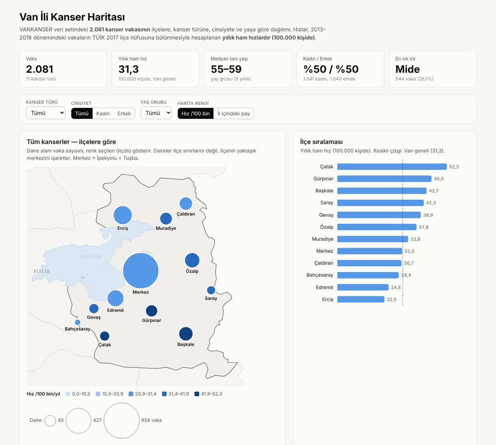

# Van İli Kanser Haritası (2013–2018)

VANKANSER veri setindeki 2.081 kanser vakasının Van ilçelerine, kanser türüne, cinsiyete ve yaşa göre dağılımını gösteren etkileşimli harita.



## İçerik

- **Kabarcık harita:** Daire alanı vaka sayısını, renk yıllık ham hızı (100.000 kişide) ya da il içindeki payı gösterir.
- **İlçe sıralaması:** Van geneli ortalama çizgisiyle birlikte.
- **İlçe × kanser türü ısı haritası:** Göreli yoğunluk (LQ) ya da ilçe içi % dağılım.
- Kanser türlerinin cinsiyete göre dağılımı, tanı yaşı dağılımı, yıllara göre vaka sayısı ve sıralanabilir tablo.
- Filtreler: kanser türü, cinsiyet, yaş grubu.

Harita tek dosyadır: `index.html` dosyasını tarayıcıda açmak yeterli (d3 cdnjs'den yüklenir, internet gerekir).

## Dosyalar

| Dosya | İçerik |
|---|---|
| `index.html` | Üretilmiş harita (tek dosya, tarayıcıda açılır) |
| `template.html` | Harita şablonu (HTML/CSS/JS, d3 v7) |
| `aggregated.json` | Haritanın kullandığı toplulaştırılmış veri küpü |
| `ilce_ozet.csv` | İlçe bazında özet tablo |
| `provinces.json` | Van ve komşu il sınırları |
| `lakes.json` | Van Gölü ve Erçek Gölü |
| `prep.py` | Ham Excel → `aggregated.json` + `ilce_ozet.csv` |
| `build.py` | `template.html` + veri → `index.html` |
| `screenshot.png` | Ekran görüntüsü |

## Yeniden üretme

```bash
pip install pandas openpyxl
# ham dosyayı repo klasörüne koyun (git'e girmez)
python prep.py VANKANSER-1.xlsx
python build.py
```

Ham Excel'in beklenen sütunları: `İL, İLÇE, CİNSİYET, YAŞ, TARİH, TOPOLOJİ`.

## Veri gizliliği

Ham veri (hasta düzeyinde kayıtlar) bu repoda **yoktur**; `*.xlsx` dosyaları `.gitignore` ile dışarıda tutulur. Repoda ve haritada yalnızca ilçe × cinsiyet × 5 yıllık yaş grubu × yıl × tür bazında toplulaştırılmış vaka sayıları bulunur. Bazı hücrelerde vaka sayısı 1–2 olduğundan repo herkese açılmadan önce küçük hücrelerin bastırılması (ör. n<5) değerlendirilmelidir.

## Yöntem ve sınırlılıklar

- **Ham hız** = 2013–2018 vaka sayısı ÷ (2017 ilçe nüfusu × 6 yıl) × 100.000. Cinsiyet filtresinde cinsiyete özgü nüfus kullanılır.
- **Nüfus:** TÜİK ADNKS 2017, İŞKUR Van İl İşgücü Piyasası Raporu 2017, Tablo 1. Verideki "Merkez" İpekyolu ile Tuşba'nın toplamı olarak alınmıştır (2013'te ayrılan eski Merkez ilçesi).
- Hızlar **yaşa göre standardize değildir**.
- Veri setindeki toplam hız (~31/100.000/yıl) Türkiye genelindeki kanser insidansının çok altındadır. Veri büyük olasılıkla tüm vakaları değil, belirli bir kaynağın ya da 11 lokalizasyonun kayıtlarını içerir. Hızlar gerçek insidans olarak değil, ilçeler arası göreli karşılaştırma olarak okunmalıdır.
- Küçük ilçelerde (Bahçesaray, Saray, Çatak) vaka sayısı düşüktür; hız ve LQ değerleri oynaktır.
- **LQ (konum katsayısı)** = bir türün ilçedeki payı ÷ aynı türün il genelindeki payı. 1'in üstü, türün ilçede il ortalamasına göre daha sık görüldüğünü gösterir.
- Daireler ilçe sınırlarını değil, ilçenin yaklaşık merkezini işaretler.

## Kaynaklar ve lisanslar

- İl sınırları: [alpers/Turkey-Maps-GeoJSON](https://github.com/alpers/Turkey-Maps-GeoJSON)
- Göller: [Natural Earth](https://www.naturalearthdata.com/) (`@geo-maps/earth-lakes-1m`), kamu malı
- Görselleştirme: [D3.js](https://d3js.org/) v7 (ISC)
- Nüfus: [İŞKUR Van 2017 raporu](https://media.iskur.gov.tr/14320/van-2017.pdf)
